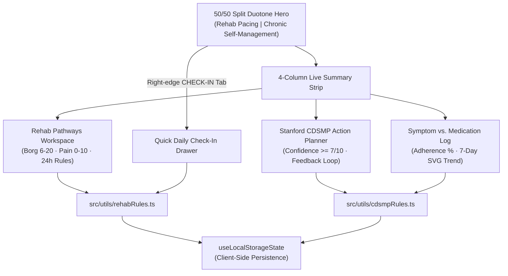

# CarePath — Rehab Pacing & Chronic Self-Management


CarePath is a static, client-side recovery pacing and chronic disease self-management web application. It pairs a high-contrast 50/50 split duotone hero with two evidence-informed interactive workflows:

1. **Pulmonary, Cardiac & Musculoskeletal Rehab Pathways**: Borg 6–20 Rating of Perceived Exertion (RPE) pacing, daily mobility checklists, 0–10 pain-threshold tracking, and deterministic 24-hour safe progression rules (`Progress +10%`, `Hold Baseline`, or `Regress -25%`).
2. **Chronic Disease Self-Management (Stanford CDSMP Model)**: Weekly micro-goal Action Planning for diabetes, hypertension, and arthritis with 0–10 confidence scoring (flagging scores `< 7/10` for down-scaling), day-by-day check-offs, structured weekly feedback loops, and symptom-vs-medication correlation logging.

> **Clinical Boundary**: CarePath is an educational pacing and self-management tracker—not clinical therapy, medical diagnosis, or emergency care.

---

## Architecture Overview



---

## Local Setup & Commands

```bash
# Install dependencies
npm install --legacy-peer-deps

# Start development server on port 3000
npm run dev

# Type-check with TypeScript
npm run lint

# Run unit, hook, and integration tests
npm test

# Build static production bundle into dist/
npm run build
```

---

## Automated Testing

Unit, hook, and React Testing Library integration tests cover both happy-path (**Blue Pill**) and adversarial/edge-case (**Red Pill**) scenarios:

- `src/utils/rehabRules.test.ts`: Borg RPE zone mapping, track target bounds, green/amber/red safe progression rules, 24-hour pain irritability spikes, and out-of-range input validation.
- `src/utils/cdsmpRules.test.ts`: Stanford CDSMP `< 7/10` confidence flagging, deterministic goal scale-down logic, weekly completion math, and empty/invalid log recovery.
- `src/hooks/useLocalStorageState.test.ts`: Browser storage synchronization and malformed JSON recovery.
- `src/App.test.tsx`: End-to-end user flows across the split hero, Quick Check-In drawer, Rehab logger, CDSMP Action Planner, and Symptom-vs-Medication filters.

---

## GitHub Pages Deployment

Automated deployment is configured via `.github/workflows/deploy.yml` on pushes to `main` using Node.js `22` and `npm install --legacy-peer-deps`. `vite.config.ts` automatically resolves the GitHub Pages repository `base` path from `GITHUB_REPOSITORY` during CI builds while keeping `/` for local and root-domain hosting.
