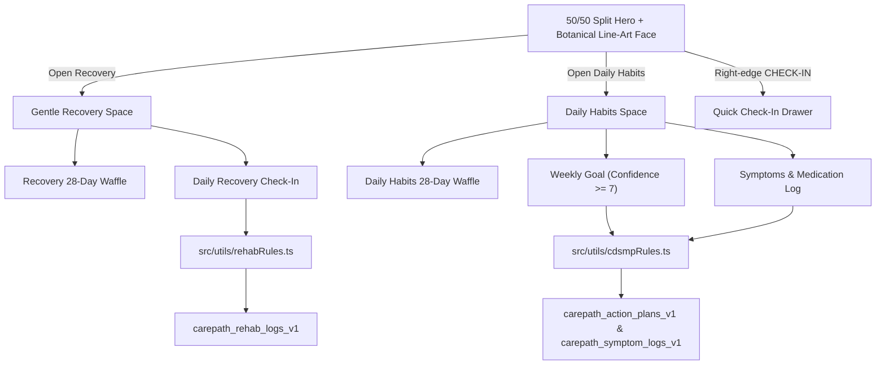

# CarePath — Gentle Recovery & Daily Habits


CarePath keeps **Gentle Recovery** and **Daily Habits** completely independent so users can track either—or both simultaneously—without intermingling recovery pacing with chronic habit logs.

1. **Gentle Recovery (Cyan Space)**:
   - Opens directly from the left hero panel (`Open Recovery`).
   - Features its own **Recovery 28-Day Waffle** (`Good / Steady / Rest`), tap-based daily check-ins for **Breathing**, **Heart**, and **Joints & Muscles**, and safe next-step pacing rules.
2. **Daily Habits (Lime Space)**:
   - Opens directly from the right hero panel (`Open Daily Habits`).
   - Features its own **Daily Habits 28-Day Waffle** (`On track / Moderate / Missed or Flare`) alongside **Weekly Goal** (`1–10` confidence taps & `M–S` check-offs) and **Symptoms & Medication** logging.

---

## Architecture Overview



---

## Local Setup & Commands

```bash
# Install dependencies
npm install --legacy-peer-deps

# Start development server on port 3000
npm run dev

# Type-check with TypeScript
npm run lint

# Run unit, hook, and integration tests
npm test

# Build static production bundle into dist/
npm run build
```

---

## Automated Testing

- `src/utils/rehabRules.test.ts`: Borg effort mapping, safe progression rules, 24-hour flare holds, and validation.
- `src/utils/cdsmpRules.test.ts`: `< 7/10` confidence coaching, frequency scale-down logic, weekly completion math, and empty/invalid log recovery.
- `src/hooks/useLocalStorageState.test.ts`: Local persistence and malformed JSON recovery.
- `src/components/trends/ProgressWaffle.test.tsx`: Independent Recovery vs. Daily Habits 28-day waffle rendering and empty-state safety.
- `src/App.test.tsx`: Dual hero routing into independent spaces, simultaneous independent tracking, Quick Check-In drawer, and validation/filter edge cases.
